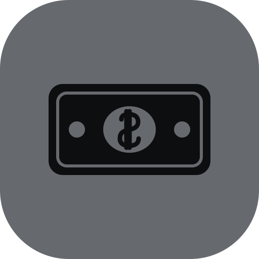

<div align="center">



# RetroFin

**English** · [Português](README.pt-BR.md)

A personal finance tracker that logs spending on its own: it imports bank statements, reads the bank notifications on your phone and categorizes everything with AI.


</div>

> The app interface is in Brazilian Portuguese and targets Brazilian banks (Nubank, Inter and others).

## Features

- **Automatic entries from notifications**: a webhook receives purchase and Pix notifications from your phone (via MacroDroid or Tasker), extracts amount, merchant and bank, and creates the transaction in the right account
- **Statement import** from OFX, CSV or text copied from the bank app
- **AI categorization** (Gemini) in batches, learning from manually corrected examples. Without an API key, a local rule engine takes over
- **AI insights** on the month's spending
- **Category budgets** with monthly goals
- **Charts** of spending by category and by month
- **Multiple bank accounts**, each with its own purpose
- **App lock** with PIN and biometrics (WebAuthn), plus auto-lock after inactivity
- **Cloud sync** with Google sign-in (Firebase), or fully local use with no account
- **Installable PWA** with offline support

## Tech stack

| Layer | Technology |
| --- | --- |
| UI | React 19, TypeScript, Tailwind CSS 4, Motion, Lucide |
| Server | Express (`/api` routes) with Firebase Admin |
| Data | Cloud Firestore (sync) or `localStorage` (local mode) |
| Auth | Firebase Authentication (Google or anonymous) |
| AI | `@google/genai` with structured JSON output |
| PWA | `vite-plugin-pwa` (Workbox) |

## Architecture

```
Phone (MacroDroid / Tasker)
   └── POST /api/notifications/webhook?userId=…
             ├── extracts amount, bank and merchant from the notification
             ├── categorizes it (local rules)
             └── writes to users/{uid}/transactions (Firebase Admin)

App (PWA)
   ├── Firestore ............. accounts, transactions and goals (synced)
   ├── POST /api/categorize .. batch categorization with Gemini
   └── POST /api/ai-insights . monthly spending analysis
```

Firestore security rules (`firestore.rules`) only let each user read and write their own data.

## Getting started

Requirements: Node.js 22+ (or Bun) and, optionally, a [Gemini API key](https://aistudio.google.com/apikey).

```bash
bun install                 # or npm install
cp .env.example .env        # then fill in GEMINI_API_KEY
bun run dev                 # http://localhost:3000
```

To use your own Firebase project, replace the values in `firebase-applet-config.json` with your Web app's config and deploy `firestore.rules` from the Firebase console.

| Script | What it does |
| --- | --- |
| `dev` | Express server + Vite with hot reload |
| `build` | builds the app into `dist/` and the server into `server.js` |
| `start` | serves the production build |
| `lint` | type check with `tsc` |

## Automatic entries with MacroDroid

1. In the app, open the automation hub and copy the webhook URL (it already includes your `userId`).
2. In MacroDroid, create a macro with the **Notification received** trigger, filtered to your bank apps.
3. Add an **HTTP Request** action: method `POST`, JSON body with the notification's `app`, `title` and `text`.

Example body:

```json
{ "app": "Nubank", "title": "Compra aprovada", "text": "Você pagou R$ 38,50 em Padaria Bella Vista" }
```

## License

[MIT](LICENSE)
