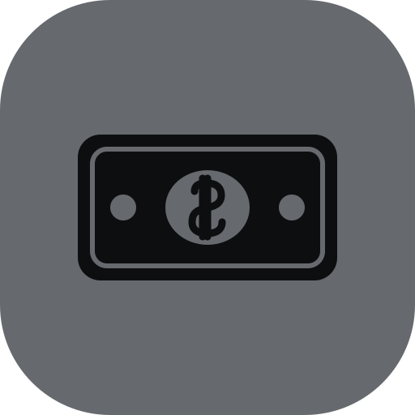

<div align="center">



# RetroFin

[English](README.md) · **Português**

Controle de finanças pessoais que lança os gastos sozinho: importa extratos, lê as notificações do banco no celular e categoriza tudo com IA.


</div>

## Funcionalidades

- **Lançamento automático por notificação**: um webhook recebe as notificações de compra e Pix do celular (via MacroDroid ou Tasker), extrai valor, estabelecimento e banco e cria a transação na conta certa
- **Importação de extratos** em OFX, CSV ou texto copiado do app do banco
- **Categorização com IA** (Gemini) em lote, aprendendo com exemplos corrigidos manualmente. Sem chave de API, um motor de regras local assume
- **Insights da IA** sobre os gastos do mês
- **Orçamento por categoria** com metas mensais
- **Gráficos** de gastos por categoria e por mês
- **Várias contas bancárias** (Nubank, Inter e outras), com finalidade de cada conta
- **Bloqueio do app** com PIN e biometria (WebAuthn) e bloqueio automático por inatividade
- **Sincronização na nuvem** com login Google (Firebase), ou uso 100% local sem conta
- **PWA instalável** com uso offline

## Stack

| Camada | Tecnologia |
| --- | --- |
| Interface | React 19, TypeScript, Tailwind CSS 4, Motion, Lucide |
| Servidor | Express (rotas `/api`) com Firebase Admin |
| Dados | Cloud Firestore (sincronização) ou `localStorage` (modo local) |
| Login | Firebase Authentication (Google ou anônimo) |
| IA | `@google/genai`, com saída em JSON estruturado |
| PWA | `vite-plugin-pwa` (Workbox) |

## Arquitetura

```
Celular (MacroDroid / Tasker)
   └── POST /api/notifications/webhook?userId=…
             ├── extrai valor, banco e estabelecimento da notificação
             ├── categoriza (regras locais)
             └── grava em users/{uid}/transactions (Firebase Admin)

App (PWA)
   ├── Firestore ............. contas, transações e metas (sincronizado)
   ├── POST /api/categorize .. categorização em lote com Gemini
   └── POST /api/ai-insights . análise dos gastos do mês
```

As regras do Firestore (`firestore.rules`) só permitem que cada usuário leia e grave os próprios dados.

## Como rodar

Pré-requisitos: Node.js 22+ (ou Bun) e, opcionalmente, uma [chave da API do Gemini](https://aistudio.google.com/apikey).

```bash
bun install                 # ou npm install
cp .env.example .env        # e preencha GEMINI_API_KEY
bun run dev                 # http://localhost:3000
```

Para usar seu próprio projeto Firebase, troque os valores de `firebase-applet-config.json` pelos do seu app Web e publique `firestore.rules` no console do Firebase.

| Script | O que faz |
| --- | --- |
| `dev` | servidor Express + Vite com hot reload |
| `build` | build do app em `dist/` e do servidor em `server.js` |
| `start` | serve o build de produção |
| `lint` | checagem de tipos com `tsc` |

## Lançamentos automáticos com MacroDroid

1. No app, abra a central de automação e copie a URL do webhook (ela já inclui o seu `userId`).
2. No MacroDroid, crie uma macro com o gatilho **Notificação recebida** filtrando os apps dos bancos.
3. Adicione a ação **Requisição HTTP**: método `POST`, corpo JSON com `app`, `title` e `text` da notificação.

Exemplo de corpo:

```json
{ "app": "Nubank", "title": "Compra aprovada", "text": "Você pagou R$ 38,50 em Padaria Bella Vista" }
```

## Licença

[MIT](LICENSE)
